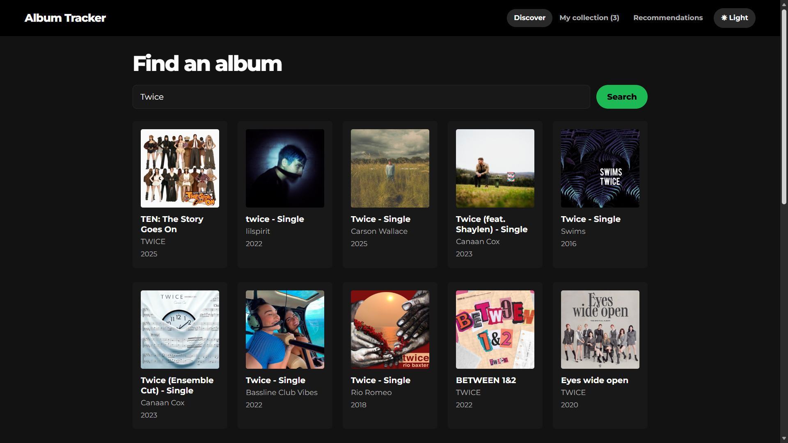
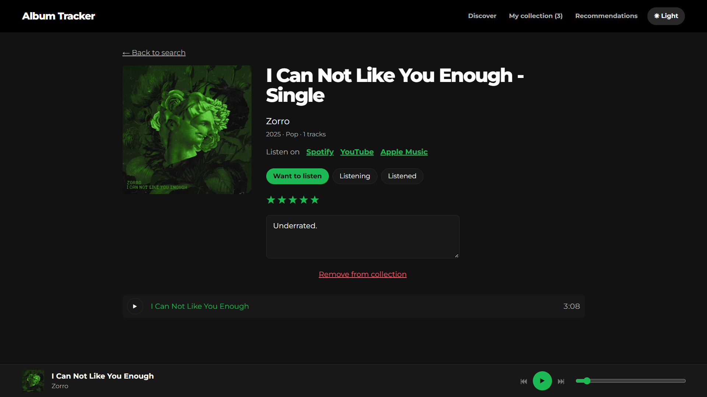
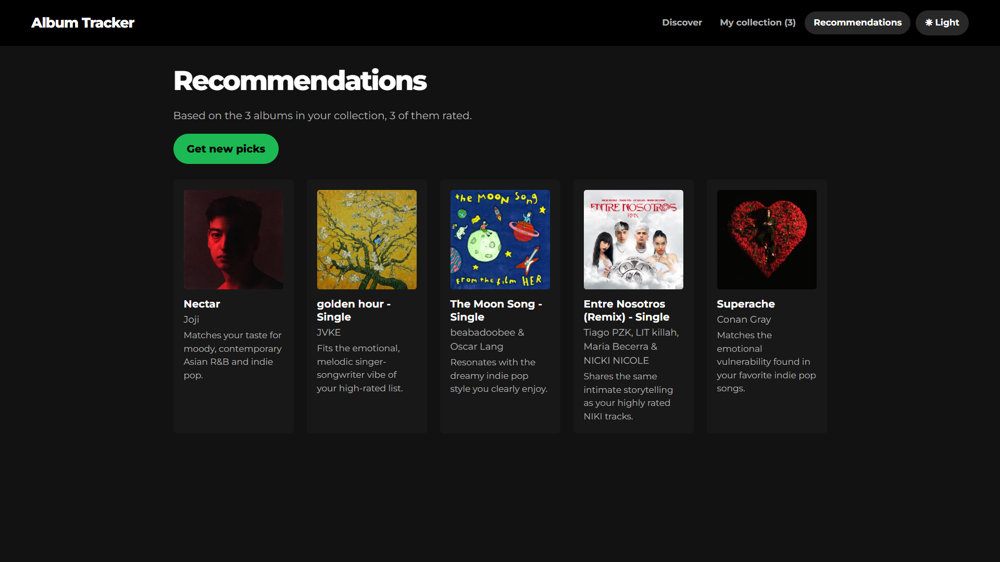

# Album Tracker

Album Tracker is a React web app for finding albums, playing available 30-second previews, and saving a personal music collection. Users can track listening status, add ratings and notes, and receive LLM-powered recommendations based on the user's saved albums and ratings.

**Live demo:** https://album-tracker-nu.vercel.app/

## Screenshots

### Search results



### Album page



### Recommendations



## Features

- Search albums by title or artist.
- View album details, tracks, and available iTunes previews.
- Save albums, set listening status, rate them, and add notes.
- Filter, search, sort, export, and import the saved collection.
- Get Gemini-based recommendations after saving at least three albums.
- Switch between light and dark themes.

## Tech stack

- React and Vite
- React Context API and `localStorage`
- iTunes Search API
- Deezer API and widget
- Google Gemini API
- Vercel for deployment

## Run locally

1. Clone the repository and open the project folder:

   ```bash
   git clone https://github.com/dev-by-kem/album-tracker.git
   cd album-tracker
   ```

2. Install dependencies:

   ```bash
   npm install
   ```

3. Create `.env.local` beside `package.json`:

   ```env
   GEMINI_API_KEY=your_gemini_api_key
   ```

4. Start the app:

   ```bash
   npm run dev
   ```

## Limitations

- The collection is saved only in the current browser and device.
- iTunes previews are limited to about 30 seconds and are not available for every track.
- Deezer playback depends on album availability and the user's Deezer login.
- Recommendations require internet access, a Gemini API key, and at least three saved albums.

## Privacy and disclaimer

The recommendation feature sends saved album titles, artists, ratings, and listening statuses to Gemini. Personal notes are not sent. This student project is not affiliated with Apple, Spotify, Deezer, Google, or Vercel.

## Appendix B. Reflection Questions

### 1. Why is the audio element stored in a `useRef` instead of `useState`?

The audio object needs to stay available while the user moves around the app, but it does not need to refresh the screen by itself. Using `useState` for it would cause unnecessary re-renders, while `useRef` keeps one audio instance and updates only the parts of the interface that need to change.

### 2. Why do all API calls live in `services/` instead of inside components?

API calls are placed in `services/` so the components do not become too crowded. This makes the pages easier to read and allows the same request functions to be reused instead of writing the API code again in different components.

### 3. Why can the Gemini key not be placed in React code? What could happen if you pushed it to GitHub?

The Gemini key cannot be placed in React code because anyone using the app could access it. If the key is pushed to GitHub, someone could steal it and misuse it by using up the API quota or creating charges on the account.

### 4. Why is this recommender an LLM prompt and not a trained machine learning model? Give one strength and one weakness.

This is an LLM prompt because the project does not have enough music data or resources to train its own machine learning model. Its strength is that the recommendation feature can be built faster, but its weakness is that the suggestions can be inconsistent and depend on the API and internet connection.

### 5. Describe the hardest bug you hit and how you fixed it.

One of the hardest issues I encountered was copying code from the laboratory manual into the project. When I selected multiple lines, some lines were accidentally changed or pasted in the wrong order, which caused syntax errors and other bugs. I fixed the problems by comparing the affected code with the manual, restoring the correct order, and testing each section after making corrections.
